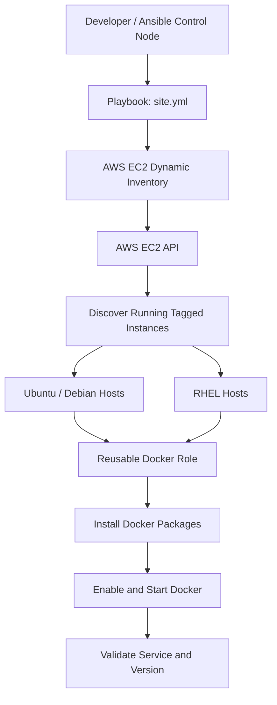

# 🚀 Multi-OS Docker Deployment with Ansible and AWS EC2 Dynamic Inventory

[](https://www.ansible.com/)
[](https://aws.amazon.com/ec2/)
[](https://www.docker.com/)

An enterprise-style Ansible project that installs, starts, enables, and validates Docker Engine across AWS EC2 instances running Debian-family and Red Hat-family Linux distributions. It uses AWS EC2 dynamic inventory and a reusable Ansible role.

---

## 📑 Table of Contents

- [Project Overview](#-project-overview)
- [Architecture](#-architecture)
- [Technology Stack](#-technology-stack)
- [Repository Structure](#-repository-structure)
- [How It Works](#-how-it-works)
- [Run the Project](#-run-the-project)
- [Validation](#-validation)
- [Engineering Practices](#-engineering-practices)
- [Outcome](#-outcome)

---

## 🎯 Project Overview

**Objective:** Automate Docker installation and service configuration across a mixed-OS EC2 fleet from a single Ansible control node.

**Key capabilities**
- Discovers running EC2 instances dynamically in AWS.
- Groups targets using EC2 tags instead of maintaining a static host list.
- Uses a reusable role to separate OS-specific installation logic from orchestration.
- Supports Debian-family and Red Hat-family systems.
- Enables and starts Docker, then validates service state and version.
- Uses privilege escalation for administrative operations.

---

## 🏗️ Architecture



**Deployment flow**
1. Ansible queries AWS through the `amazon.aws.aws_ec2` inventory plugin.
2. The inventory selects running EC2 instances matching the configured application tag.
3. Tag-based groups organize the targets.
4. `site.yml` invokes the Docker role.
5. The role chooses OS-specific tasks using Ansible facts.
6. Docker is installed, enabled, and started.
7. Post-deployment checks validate the service and installed version.

---

## 🧰 Technology Stack

| Technology | Purpose |
|---|---|
| AWS EC2 | Hosts Linux instances |
| Ansible | Configuration management and orchestration |
| EC2 dynamic inventory | Discovers targets from AWS |
| Ansible roles | Encapsulates reusable Docker deployment logic |
| Docker Engine | Container runtime |
| YAML | Inventory, playbook, and role configuration |
| Git and GitHub | Version control and project publishing |

---

## 📁 Repository Structure

```text
docker-role-demo/
├── inventory/
│   └── aws_ec2.yml
├── docker/
│   ├── defaults/main.yml
│   ├── handlers/main.yml
│   ├── meta/main.yml
│   ├── tasks/
│   │   ├── main.yml
│   │   ├── debian.yml
│   │   └── redhat.yml
│   ├── templates/
│   ├── vars/main.yml
│   └── README.md
├── requirements.yml
├── site.yml
├── .gitignore
└── README.md
```

---

## ⚙️ How It Works

### AWS EC2 dynamic inventory

The inventory discovers hosts at runtime instead of hardcoding EC2 IP addresses.

Example `inventory/aws_ec2.yml`:

```yaml
---
plugin: amazon.aws.aws_ec2

regions:
  - ap-southeast-2

filters:
  instance-state-name:
    - running
  tag:Application:
    - ansible-day05

keyed_groups:
  - key: ec2_tags.Environment
    prefix: env
    separator: "_"
  - key: ec2_tags.Application
    prefix: app
    separator: "_"
  - key: ec2_tags.Role
    prefix: role
    separator: "_"
  - key: ec2_tags.OS
    prefix: os
    separator: "_"

compose:
  ansible_host: public_ip_address
```

Ensure the EC2 instances have tags matching the filter and that your playbook targets a group actually created by those tags.

### OS-aware task selection

The role's `tasks/main.yml` includes the correct task file based on the detected OS family:

```yaml
---
- name: Install Docker on Debian family
  ansible.builtin.include_tasks: debian.yml
  when: ansible_facts.os_family == "Debian"

- name: Install Docker on RedHat family
  ansible.builtin.include_tasks: redhat.yml
  when: ansible_facts.os_family == "RedHat"
```

This keeps OS-specific repository and package steps separate while maintaining one role interface.

---

## ▶️ Run the Project

Run commands from the project directory on your Ansible control node.

### 1. Install dependencies

```bash
ansible-galaxy collection install -r requirements.yml
python -m pip install boto3 botocore
```

Activate your Python virtual environment first if you use one.

### 2. Verify AWS credentials

```bash
aws sts get-caller-identity
```

Use a secure AWS CLI profile or another supported credential method. The identity needs permission to describe EC2 instances in the target region.

### 3. Inspect discovered hosts

```bash
ansible-inventory -i inventory/aws_ec2.yml --graph
```

### 4. Test connectivity

```bash
ansible all -i inventory/aws_ec2.yml -m ping
```

### 5. Deploy Docker

```bash
ansible-playbook -i inventory/aws_ec2.yml site.yml
```

---

## ✅ Validation

Check Docker daemon information on the discovered hosts:

```bash
ansible all -i inventory/aws_ec2.yml -b -m command -a "docker info"
```

Check the installed version:

```bash
ansible all -i inventory/aws_ec2.yml -b -m command -a "docker --version"
```

The `-b` flag enables privilege escalation for commands that need elevated access, including Docker socket access when the SSH user is not in the Docker group.

**Expected result**
- All intended hosts are reachable.
- Docker is installed for supported OS families.
- Docker is enabled and running.
- Post-deployment checks pass.
- The play recap reports no failed or unreachable hosts.

---

## 🛠️ Engineering Practices

- **Dynamic discovery:** Use AWS tags and runtime inventory rather than fixed IP addresses.
- **Separation of concerns:** Keep orchestration in the playbook and installation logic in the role.
- **OS-aware automation:** Select tasks using gathered Ansible facts.
- **Privilege escalation:** Use `become` for system-level package and service operations.
- **Validation:** Check service state and Docker version after deployment.
- **Credential safety:** Never commit AWS keys, private SSH keys, API tokens, or other secrets.
- **Reusability:** Keep role defaults and metadata organized for future extension or publication.

---

## 🎉 Outcome

This project demonstrates a practical configuration-management workflow for a mixed Linux EC2 fleet: dynamically discover instances, apply a reusable role, handle OS-specific installation, and verify the resulting service state.

**Skills demonstrated:** AWS EC2, dynamic inventory, Ansible roles, multi-OS automation, privilege escalation, service validation, YAML, Git, and GitHub.
