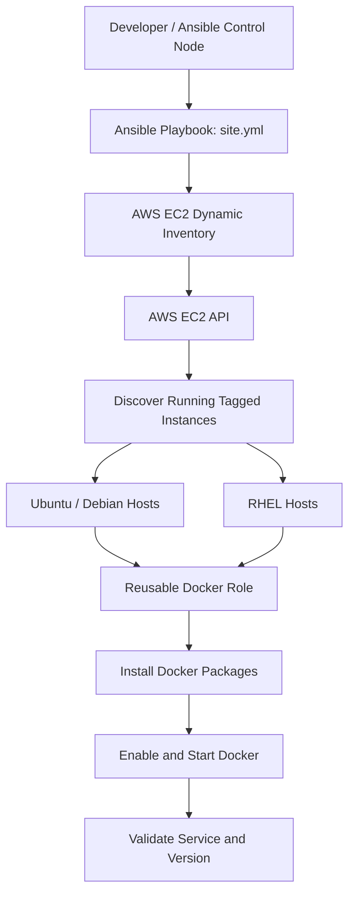

from pathlib import Path

content = r'''# 🚀 Multi-OS Docker Deployment with Ansible and AWS EC2 Dynamic Inventory

[](https://www.ansible.com/)
[](https://aws.amazon.com/ec2/)
[](https://www.docker.com/)
[](https://www.redhat.com/)

An enterprise-style Ansible project that installs, starts, enables, and validates Docker Engine across multiple AWS EC2 instances running Debian-family and Red Hat-family Linux distributions. It uses **AWS EC2 dynamic inventory** and a **reusable Ansible role** to keep the deployment scalable and maintainable.

---

## 📑 Table of Contents

- [Project Overview](#-project-overview)
- [Architecture](#-architecture)
- [Technology Stack](#-technology-stack)
- [Repository Structure](#-repository-structure)
- [How It Works](#-how-it-works)
- [Dynamic Inventory](#-dynamic-inventory)
- [Reusable Docker Role](#-reusable-docker-role)
- [Run the Project](#-run-the-project)
- [Validation](#-validation)
- [Engineering Practices](#-engineering-practices)
- [Outcome](#-outcome)

---

## 🎯 Project Overview

### Objective

Automate Docker installation and service configuration across a mixed-OS EC2 fleet from a single Ansible control node.

### Key capabilities

- Discovers running EC2 instances dynamically in AWS.
- Groups targets using EC2 tags instead of maintaining a static host list.
- Uses a reusable role to separate OS-specific installation logic from orchestration.
- Supports Debian-family and Red Hat-family systems.
- Enables and starts the Docker service.
- Validates the service state and Docker version after deployment.
- Uses privilege escalation for administrative operations.

---

## 🏗️ Architecture



### Deployment flow

1. Ansible queries AWS using the `amazon.aws.aws_ec2` inventory plugin.
2. The inventory selects running EC2 instances with the configured application tag.
3. Tag-based groups organize targets for the playbook.
4. `site.yml` invokes the reusable Docker role.
5. The role selects the appropriate task file based on the target OS family.
6. Docker is installed, enabled, and started.
7. Post-deployment checks verify the service and installed version.

---

## 🧰 Technology Stack

| Technology | Purpose |
|---|---|
| AWS EC2 | Hosts the Linux instances |
| Ansible | Configuration management and orchestration |
| AWS EC2 dynamic inventory | Discovers target instances from AWS |
| Ansible roles | Encapsulates reusable Docker deployment logic |
| Docker Engine | Container runtime installed on targets |
| YAML | Inventory, playbook, and role configuration |
| Git and GitHub | Version control and project publishing |

---

## 📁 Repository Structure

```text
docker-role-demo/
├── inventory/
│   └── aws_ec2.yml
├── docker/
│   ├── defaults/
│   │   └── main.yml
│   ├── handlers/
│   │   └── main.yml
│   ├── meta/
│   │   └── main.yml
│   ├── tasks/
│   │   ├── main.yml
│   │   ├── debian.yml
│   │   └── redhat.yml
│   ├── templates/
│   ├── vars/
│   │   └── main.yml
│   └── README.md
├── requirements.yml
├── site.yml
├── .gitignore
└── README.md
```

---

## ⚙️ How It Works

### 1. AWS EC2 dynamic inventory

The inventory plugin retrieves hosts from AWS at runtime. This avoids hardcoding EC2 IP addresses and lets the project discover instances based on tags and state.

Example inventory configuration:

```yaml
---
plugin: amazon.aws.aws_ec2

regions:
  - ap-southeast-2

filters:
  instance-state-name:
    - running
  tag:Application:
    - ansible-day05

keyed_groups:
  - key: ec2_tags.Environment
    prefix: env
    separator: "_"
  - key: ec2_tags.Application
    prefix: app
    separator: "_"
  - key: ec2_tags.Role
    prefix: role
    separator: "_"
  - key: ec2_tags.OS
    prefix: os
    separator: "_"

compose:
  ansible_host: public_ip_address
```

The EC2 instances must have tags matching the inventory filter. The playbook's target group must also match the groups produced by your actual EC2 tags.

### 2. OS-aware task selection

The role's main task file selects the appropriate installation tasks using Ansible facts:

```yaml
---
- name: Install Docker on Debian family
  ansible.builtin.include_tasks: debian.yml
  when: ansible_facts.os_family == "Debian"

- name: Install Docker on RedHat family
  ansible.builtin.include_tasks: redhat.yml
  when: ansible_facts.os_family == "RedHat"
```

This keeps distribution-specific repository and package operations separate while exposing a single role interface to the playbook.

### 3. Playbook orchestration

`site.yml` targets the appropriate dynamic inventory group, escalates privileges, gathers facts, applies the role, and runs post-deployment checks.

The role is responsible for the OS-specific Docker installation and service management. The playbook coordinates the rollout and verifies the result.

---

## ▶️ Run the Project

Run these commands from the project directory on your Ansible control node.

### 1. Install required collection and Python dependencies

```bash
ansible-galaxy collection install -r requirements.yml
python -m pip install boto3 botocore
```

If you use a Python virtual environment, activate it before installing dependencies.

### 2. Verify AWS authentication

Configure AWS credentials using your preferred secure method, such as an AWS CLI profile or environment-based credentials. Ensure the identity can describe EC2 instances in the target region.

```bash
aws sts get-caller-identity
```

### 3. Inspect discovered hosts

```bash
ansible-inventory -i inventory/aws_ec2.yml --graph
```

Confirm that the expected running instances appear in the inventory and are assigned to the expected groups.

### 4. Test connectivity

```bash
ansible all -i inventory/aws_ec2.yml -m ping
```

### 5. Run the deployment

```bash
ansible-playbook -i inventory/aws_ec2.yml site.yml
```

---

## ✅ Validation

### Check Docker service and version across discovered hosts

```bash
ansible all -i inventory/aws_ec2.yml -b -m command -a "docker info"
```

The `-b` flag uses privilege escalation, which is useful when the remote SSH user does not have permission to access the Docker socket directly.

Check the installed version:

```bash
ansible all -i inventory/aws_ec2.yml -b -m command -a "docker --version"
```

### Expected result

- All intended hosts are reachable.
- Docker packages are installed for supported OS families.
- The Docker service is enabled and running.
- Post-deployment assertions pass.
- The play recap reports no failed or unreachable hosts.

---

## 🛠️ Engineering Practices

- **Dynamic discovery:** Use AWS tags and runtime inventory instead of fixed IP addresses.
- **Separation of concerns:** Keep orchestration in the playbook and installation logic in the role.
- **OS-aware automation:** Select tasks using gathered Ansible facts.
- **Privilege escalation:** Use `become` for system-level package and service operations.
- **Validation:** Check service state and Docker version after deployment.
- **Version control:** Track changes through Git and publish the project in GitHub.
- **Credential safety:** Do not commit AWS access keys, private SSH keys, API tokens, or other secrets.
- **Reusability:** Keep role defaults and metadata organized so the role can be extended or published independently.

---

## 🎉 Outcome

This project demonstrates a practical configuration-management workflow for a mixed Linux EC2 fleet: discover instances dynamically, apply a reusable role, handle OS-specific installation tasks, and verify the resulting service state.

It provides hands-on experience with **AWS EC2, dynamic inventory, Ansible roles, multi-OS automation, privilege escalation, service validation, and Git-based project delivery**.
'''
path = Path("/mnt/data/README.md")
path.write_text(content, encoding="utf-8")
print(f"Created: {path}\nSize: {path.stat().st_size:,} bytes")
