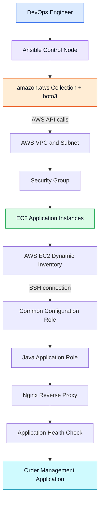
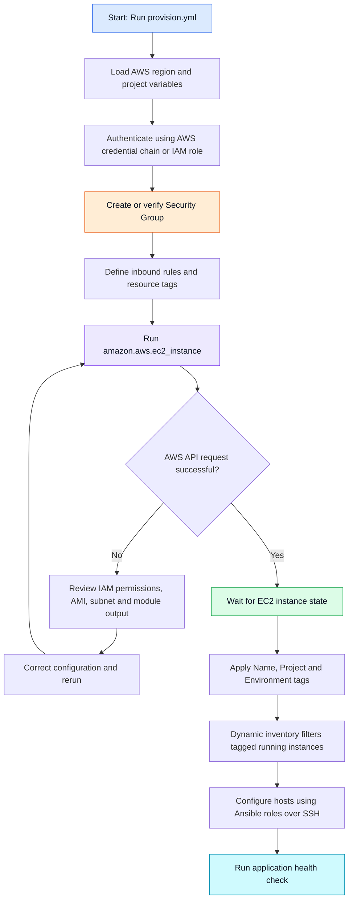

import pypandoc, os

md = r"""# 🚀 Enterprise Java Order Management Deployment on AWS Using Ansible

<p align="center">


</p>

> A hands-on AWS DevOps project that uses reusable Ansible roles, AWS EC2 dynamic inventory, and Jinja2 templates to provision infrastructure and deploy a Java-based Order Management application.

---

## 📌 Table of Contents

- [🎯 Project Objective](#-project-objective)
- [🏗️ Architecture](#️-architecture)
- [☁️ How Ansible Creates EC2 Instances](#️-how-ansible-creates-ec2-instances)
- [🧰 Technology Stack](#-technology-stack)
- [📁 Project Structure](#-project-structure)
- [⚙️ AWS Configuration](#️-aws-configuration)
- [🔐 AWS Authentication and Ansible Vault](#-aws-authentication-and-ansible-vault)
- [🧩 Ansible Roles](#-ansible-roles)
- [🔎 Dynamic Inventory](#-dynamic-inventory)
- [🚀 Deployment Flow](#-deployment-flow)
- [🩺 Application Health Check](#-application-health-check)
- [🧪 Validation](#-validation)
- [🔁 Idempotency and Rolling Deployment](#-idempotency-and-rolling-deployment)
- [🛡️ Security](#️-security)
- [💰 Cleanup and Cost Control](#-cleanup-and-cost-control)
- [📈 Future Enhancements](#-future-enhancements)
- [👨‍💻 Author](#-author)

---

## 🎯 Project Objective

Automate the deployment of a Java Order Management application on AWS using Ansible.

The project demonstrates how to:

- Provision EC2 instances and security groups through AWS APIs.
- Discover instances using AWS EC2 dynamic inventory.
- Organize automation into reusable Ansible roles.
- Configure Java and Nginx on application servers.
- Generate service and reverse-proxy configuration using Jinja2 templates.
- Validate application availability and make repeat runs predictable.

## 🏗️ Architecture



**Important:** Ansible creates AWS resources through AWS APIs from the control node. It then discovers the running instances and connects to them (typically over SSH) to configure the operating system and application.

## ☁️ How Ansible Creates EC2 Instances



### EC2 provisioning sequence

1. `provision.yml` runs on the Ansible control node.
2. AWS credentials and region are resolved from the configured AWS credential provider.
3. The security-group role creates or verifies the required network rules.
4. The EC2 role calls `amazon.aws.ec2_instance` with the selected AMI, instance type, subnet, key pair, security group, storage, and tags.
5. Ansible waits for the requested instance state.
6. The dynamic inventory plugin discovers running instances matching the project tags.
7. The configuration playbook connects to the instances and applies the application roles.

## 🧰 Technology Stack

| Technology | Purpose |
|---|---|
| AWS EC2 | Hosts the application servers |
| AWS VPC and Subnets | Network isolation and connectivity |
| AWS Security Groups | Controls inbound and outbound traffic |
| Ansible | Infrastructure and configuration automation |
| `amazon.aws` collection | AWS modules and dynamic inventory plugin |
| Python, boto3, botocore | AWS SDK dependencies for Ansible modules |
| Ansible Vault | Encrypts secrets stored in Ansible files |
| Jinja2 | Templates systemd and Nginx configuration |
| Java 17 | Runs the Java application |
| Nginx | Reverse proxy in front of the application |
| Git and GitHub | Version control and project collaboration |

## 📁 Project Structure

```text
aws-java-project/
├── group_vars/
│   └── all.yml
├── inventory/
│   └── aws_ec2.yml
├── playbooks/
│   ├── provision.yml
│   ├── configure.yml
│   └── site.yml
├── roles/
│   ├── aws_security_group/
│   │   ├── defaults/main.yml
│   │   └── tasks/main.yml
│   ├── aws_ec2/
│   │   ├── defaults/main.yml
│   │   └── tasks/main.yml
│   ├── common/
│   │   └── tasks/main.yml
│   ├── java_app/
│   │   ├── defaults/main.yml
│   │   ├── tasks/main.yml
│   │   ├── handlers/main.yml
│   │   └── templates/order-management.service.j2
│   └── nginx/
│       ├── defaults/main.yml
│       ├── tasks/main.yml
│       ├── handlers/main.yml
│       └── templates/order-management.conf.j2
├── files/
│   └── order-management.jar
├── ansible.cfg
├── requirements.yml
├── .gitignore
└── README.md
```

*Adjust the paths in the examples if your repository uses a different folder layout.*

## ⚙️ AWS Configuration

Set environment-specific values in `group_vars/all.yml`. Typical variables include:

```yaml
---
project_name: order-management
environment: dev
aws_region: ap-south-1
application_name: order-management
application_port: 8080
nginx_port: 80

ami_id: "ami-REPLACE_ME"
vpc_id: "vpc-REPLACE_ME"
subnet_id: "subnet-REPLACE_ME"
key_name: "REPLACE_WITH_KEY_PAIR"
allowed_ssh_cidr: "REPLACE_WITH_TRUSTED_CIDR"

ec2_instance_type: t3.micro
ec2_instance_count: 2
```

Replace all placeholders with values from your own AWS account and selected region. The AMI, VPC, subnet, key pair, and security group must be compatible. Keep SSH restricted to your trusted IP/CIDR; do not use `0.0.0.0/0` for SSH access.

Install the collection from `requirements.yml`:

```yaml
---
collections:
  - name: amazon.aws
```

```bash
ansible-galaxy collection install -r requirements.yml
python3 -m pip install boto3 botocore
```

## 🔐 AWS Authentication and Ansible Vault

Prefer an IAM role, AWS IAM Identity Center profile, or another supported temporary-credential provider. For a named AWS CLI profile:

```bash
export AWS_PROFILE=dev-sandbox
export AWS_REGION=ap-south-1
aws sts get-caller-identity
```

Use Ansible Vault only when you need to store sensitive values in Ansible files:

```bash
ansible-vault create vault/secrets.yml
ansible-vault edit vault/secrets.yml
ansible-playbook playbooks/provision.yml --ask-vault-pass
```

Vault encrypts stored data; it does not grant AWS permissions. Do not commit plaintext credentials, Vault passwords, private keys, or secret files to Git.

## 🧩 Ansible Roles

| Role | Responsibility |
|---|---|
| `aws_security_group` | Creates or verifies security-group rules and tags |
| `aws_ec2` | Provisions EC2 instances with the desired configuration and tags |
| `common` | Installs common OS packages |
| `java_app` | Installs Java, places the application artifact, and manages the systemd service |
| `nginx` | Installs Nginx and renders the reverse-proxy configuration |

Role defaults keep reusable settings configurable. Variables in `group_vars` define environment settings, while command-line extra variables can override ordinary defaults and inventory values.

## 🔎 Dynamic Inventory

The AWS EC2 inventory plugin queries AWS and selects instances based on configured regions, filters, and tags. This avoids maintaining a static list of changing EC2 addresses.

Example `inventory/aws_ec2.yml`:

```yaml
---
plugin: amazon.aws.aws_ec2
regions:
  - ap-south-1
filters:
  tag:Project: order-management
  instance-state-name:
    - running
keyed_groups:
  - key: tags.Application
    prefix: application
compose:
  ansible_host: public_ip_address
```

This example assumes public-IP connectivity from the control node. For private instances, use private networking and configure the inventory address and access path accordingly.

Inspect the discovered groups before using a group name in the playbook:

```bash
ansible-inventory -i inventory/aws_ec2.yml --graph
ansible-inventory -i inventory/aws_ec2.yml --list
```

## 🚀 Deployment Flow

Run provisioning and configuration as separate stages initially so each can be checked before moving to the next.

```bash
# 1. Validate provisioning playbook
ansible-playbook -i inventory/aws_ec2.yml playbooks/provision.yml --syntax-check

# 2. Provision the security group and EC2 instances
ansible-playbook -i inventory/aws_ec2.yml playbooks/provision.yml

# 3. Inspect dynamic inventory and confirm the target group
ansible-inventory -i inventory/aws_ec2.yml --graph

# 4. Configure application hosts (replace the group with the actual inventory group)
ansible-playbook -i inventory/aws_ec2.yml playbooks/configure.yml
```

After both stages have been validated, `playbooks/site.yml` can orchestrate them as one workflow.

The application role expects `files/order-management.jar`. The Nginx template proxies traffic to the configured application port. Make sure the Java application is actually listening on that port.

## 🩺 Application Health Check

Use an Ansible `uri` task to check the endpoint exposed by your application. For a Spring Boot application with Actuator enabled, an example endpoint is:

```yaml
- name: Wait for application health endpoint
  ansible.builtin.uri:
    url: "http://127.0.0.1:{{ application_port }}/actuator/health"
    method: GET
    status_code: 200
  register: health_result
  retries: 12
  delay: 5
  until: health_result.status == 200
```

Change the URL and expected status to match the application's actual health endpoint. A successful health check should be part of the deployment acceptance criteria.

## 🧪 Validation

```bash
ansible-galaxy collection list
ansible-doc amazon.aws.ec2_instance
ansible-playbook -i inventory/aws_ec2.yml playbooks/provision.yml --syntax-check
ansible-playbook -i inventory/aws_ec2.yml playbooks/configure.yml --syntax-check
ansible-inventory -i inventory/aws_ec2.yml --graph
```

After the instances are reachable, test connectivity using the actual group name reported by inventory:

```bash
ansible <application_group> -m ansible.builtin.ping
ansible-playbook -i inventory/aws_ec2.yml playbooks/configure.yml --check --diff
```

Check mode is a simulation and may not predict every module change or AWS side effect. Review module documentation and inspect planned changes before applying them.

## 🔁 Idempotency and Rolling Deployment

- Prefer Ansible modules that declare the desired resource state over ad hoc shell commands.
- Use stable tags and resource names so repeated runs can identify managed resources.
- Use handlers to restart services only when relevant configuration changes.
- Test a second run and review the play recap for unexpected changes.
- For rolling application updates, configure a controlled batch size with `serial`, check health after each batch, and stop the rollout if a batch fails.
- Before production use, add a tested rollback strategy and an approval step.

## 🛡️ Security

- Use least-privilege IAM policies and temporary credentials where possible.
- Restrict SSH to a trusted source and prefer private networking for production.
- Keep secrets and private keys out of Git history.
- Review inbound rules, resource tags, account, and region before deployment.
- Use TLS for public application traffic in a production design.

## 💰 Cleanup and Cost Control

AWS resources may incur charges, including EC2 instances, EBS volumes, public IPv4 addresses, and related services.

After testing:

1. Identify the resources created for this project using tags such as `Project=order-management` and `ManagedBy=Ansible`.
2. Confirm that no other workload depends on them.
3. Terminate lab instances and remove project-only security groups when safe.
4. Check for leftover volumes, snapshots, addresses, and other billable resources.
5. Review AWS billing and cost dashboards.

Do not delete resources based only on a name match in a shared account. Verify resource IDs, tags, ownership, and dependencies first.

## 📈 Future Enhancements

- Add `ansible-lint` and syntax checks to a GitHub Actions workflow.
- Add automated role tests and deployment approval gates.
- Deploy into private subnets with a controlled management path.
- Add HTTPS, load balancing, and centralized logging/monitoring.
- Add release versioning, health-gated rolling deployments, and a tested rollback workflow.

## 👨‍💻 Author

**Rajesh Kumar Samal**

GitHub: [@rajeshsamal745](https://github.com/rajeshsamal745)

---

<p align="center">
  <i>Automate consistently. Validate every deployment. Keep AWS secure and cost-aware.</i>
</p>
"""

out = "/mnt/data/README.md"
pypandoc.convert_text(md, "md", format="md", outputfile=out, extra_args=["--standalone"])
print(f"Updated {out} ({os.path.getsize(out):,} bytes)")

